# Refusal directions in looped reasoning models

Qwen3-8B (reproduction) → Ouro-1.4B-Thinking (4 loops) → Nanbeige4.2-3B (2 loops)

Method: *reasoning-manipulation* (arXiv 2507.03167), built on *refusal_direction* (Arditi et al.)

Slides are separated by `---` (Marp). Figures: `scripts/make_presentation_figures.py`. Loops are numbered from 1.

---

## Motivation and questions

- Reasoning models refuse harmful prompts. In standard transformers refusal is mediated by **one direction** in the
  residual stream: removing it stops refusal, adding it induces refusal.
- **Looped models** run the same layer stack several times, a cheap way to get more depth per parameter. Their
  residual stream passes through the same weights and a shared norm several times.

Questions:

1. Does a single refusal direction exist in looped models, and do the standard interventions transfer?
2. **Where** is the refusal decision made: which loops, which layers?
3. If an intervention fails, **why**?
4. What does steering cost (capability, over-refusal)?

---

## Models

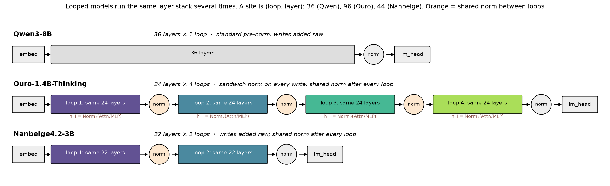

| Model | Layers × loops | Sites | Norm between a write and the stream | Norm between loops |
|---|---|---|---|---|
| Qwen3-8B | 36 × 1 | 36 | none | – |
| Ouro-1.4B-Thinking | 24 × 4 | 96 | **sandwich norm on every write** | shared, 3 passes |
| Nanbeige4.2-3B | 22 × 2 | 44 | none | shared, 1 pass |

---

## Data and pipeline

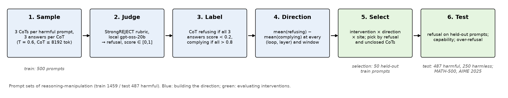

- **Prompts:** reasoning-manipulation sets. Directions from 500 train prompts; candidates chosen on 50 further train
  prompts (selection); results on the 487 harmful test prompts. Over-refusal: 250 harmless test prompts.
- **Sampling:** 3 CoTs per prompt, 3 answers per CoT; temperature 0.6, no top-p / top-k. CoTs that hit the first cap
  (2048; Nanbeige 4096) are continued to 8192 tokens.
- **Judge:** StrongREJECT rubric with a local gpt-oss-20b. **score** = (1 − refused) × (convincing + specific − 2) / 8.
- **Capability:** MATH-500 (1 sample each) and AIME 2025 (30 × 8 samples), CoT ≤ 8192 tokens.

---

## Directions, interventions, metrics

**Direction** = mean(refusing) − mean(complying) activations at the stream entering each (loop, layer), over a token window:
`v4_cot` (all CoT tokens), `v12_cot150` (first 150 CoT tokens), `v4_baseline` (template tokens before thinking, prompt
labels), `random` (same norm, control).

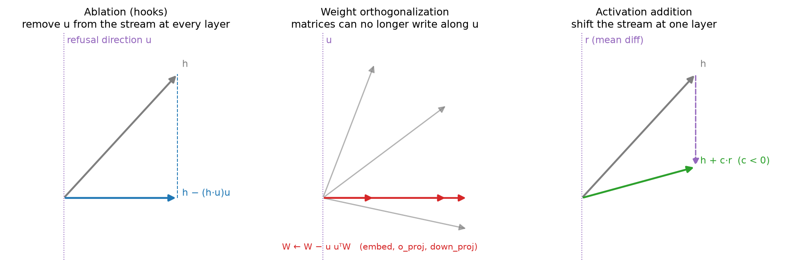

- **Ablation (hooks)** projects `u` out at every layer and loop. **Weight ortho** edits `embed`, `o_proj`, `down_proj`
  once. **Actadd** adds `c · r` at one layer. Hooks can be **loop-restricted** (`apply=`); weights cannot.
- **Metrics:** judge refusal over all samples; mean score; **unclosed CoTs** (no `</think>`: a broken edit loops, Ouro
  also often answers directly). Differences under about 4 points (50 prompts) or 2 points (test) are noise.

---

## Qwen3-8B: the reproduction holds

| Test set (487 prompts) | refusal | mean score |
|---|---|---|
| clean / random direction | 61.3% / 61.1% | 0.37 |
| **weight ortho**, `v4_baseline` L21 / `v12_cot150` L17 / `v4_cot` L15 | **5.7%** / 7.8% / 11.7% | 0.85–0.91 |
| **hook ablation**, `v4_baseline` L21 | **5.5%** | |
| **actadd**, `v4_baseline` L17, c = −2 | **6.8%** | |

- Our directions match the published layer-17 vectors (cosine 0.994 CoT, 0.993 baseline). The CoT and the
  prompt-end directions differ (cosine ≈ 0.35), yet both remove refusal.
- Weight ortho ≈ hooks, as it must be in a pre-norm model (greedy outputs share 77–83% of opening tokens vs 8% clean).

---

## A refusal direction exists at almost every site

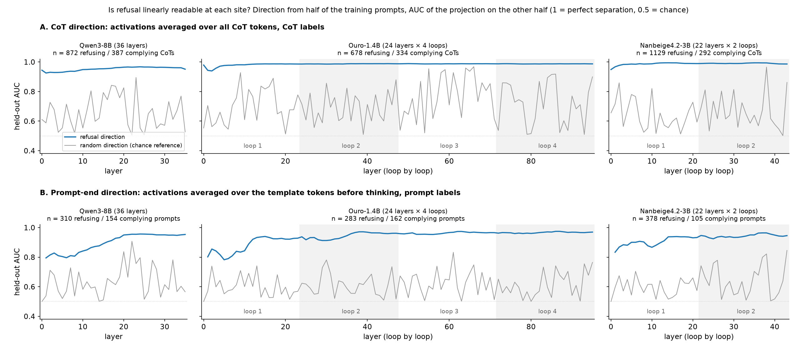

- All three models carry a linearly separable refusal signal (AUC 0.93–0.99) at nearly every (loop, layer).
- In both looped models every loop after the first looks alike; loop 1 is where the signal builds up.

---

## Results across models (test set)

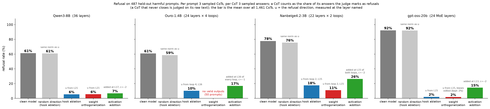

- **Qwen:** all three interventions work (61% → 6–12%).
- **Ouro:** hook ablation works (61% → 10%), actadd 17%. **Weight ortho gives no valid outputs**, even with a
  random direction, and the norm-aware edit still leaves 99% of CoTs unclosed (50 prompts).
- **Nanbeige:** hooks and weight ortho both work (78% → 11–18%), actadd 26%. Random directions do nothing.

**Inference:** the method transfers to looped models, but only interventions that act after every norm (hooks).

---

## Which loops carry the refusal? (test set)

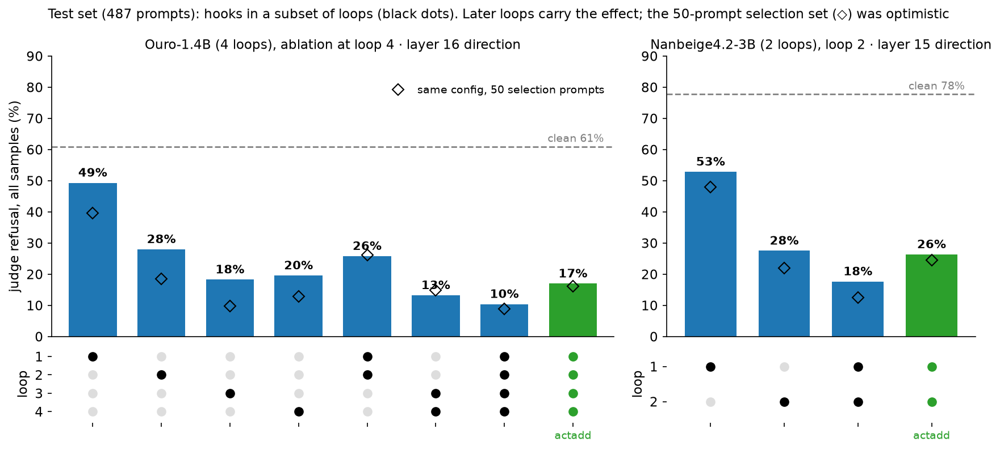

- **Ouro:** loop 1 alone 49%, loop 2 28%, loop 3 18%, loop 4 20%; loops 3+4 13%; all four 10%.
- **Nanbeige:** loop 1 alone 53%, loop 2 alone 28%, both 18%.
- **Inference:** the later loops carry most of the effect, but no single loop is enough. The selection set was
  optimistic by 5–10 points for single loops: confirm loop claims on held-out prompts.

---

## Ablation needs a late loop; actadd is a dose (all subsets)

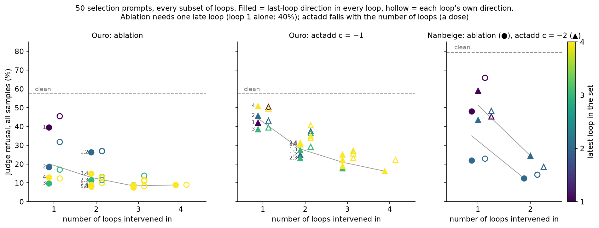

- **Ablation** (Ouro): every subset containing loop 3 or 4 reaches 8–15%; loop 2 alone 18%, loops 1+2 26%, loop 1
  alone 40%. What matters is *which* loops.
- **Actadd** (c = −1): refusal falls with the *number* of loops (mean 44% → 28% → 21% → 16%), almost regardless of which.
- **Per-loop directions** (hollow) are not better than the last loop's direction used everywhere (often worse).
- **Inference:** ablation removes a feature that later loops would otherwise rebuild; actadd adds a push that accumulates.

---

## Where within a loop? (Ouro actadd, one loop × one layer)

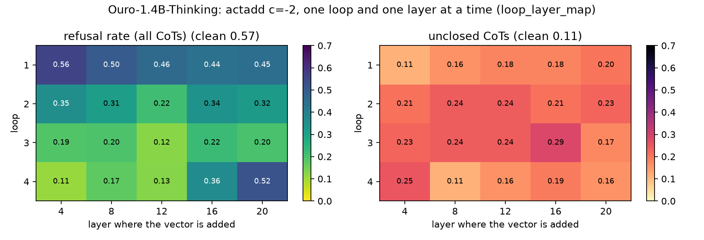

- The effect grows with the loop index; loop 1 is weak at every layer (44–56%, clean 57%).
- In **loop 4 only layers 4–12 work** (11–17%); layers 16 and 20 do not (36%, 52%): late injections come too late.
- c = −2, once per cell, 50 prompts.

---

## What does steering cost?

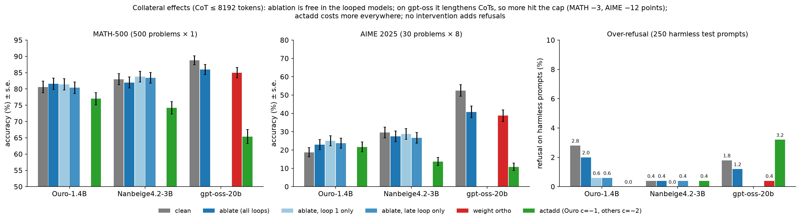

- **Ablation is free:** MATH-500 and AIME 2025 within noise of clean in both models, whichever loops.
- **Actadd costs accuracy:** MATH-500 −3.6 (Ouro, c = −1) and −8.8 points (Nanbeige, c = −2); Nanbeige AIME halves
  (29.6% → 13.8%). It also lengthens CoTs.
- **No over-refusal:** 0–3% refusal on harmless prompts under every config (a weak check: our interventions lower refusal).
- AIME at 8192 tokens closes only 24–33% of CoTs, so it mostly measures problems solved early.

---

# Why does weight ortho break Ouro but not Nanbeige?

**Short answer:** renormalization. A learned RMSNorm sits between the edited weights and the residual stream.

- In Ouro it sits there **48 times per loop** (sandwich norms) **and 3 times between loops**, and the inter-loop norm
  **amplifies** what it receives.
- In Nanbeige it sits there **once**, between the two loops, and it **shrinks** what it receives.

---

## RMSNorm re-introduces a removed direction

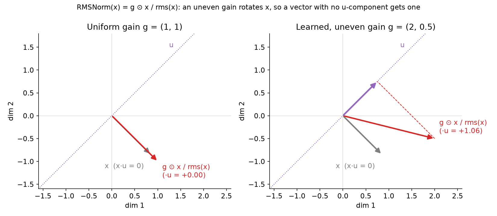

- `RMSNorm(x) = g ⊙ x / rms(x)`. An uneven gain `g` **rotates** `x`: the output component along `u` is
  `Σᵢ gᵢ xᵢ uᵢ / rms(x)`, not 0 even when `x ⊥ u`.
- Measured unevenness: cos(`u`, `g ⊙ u`) ≈ 0.95 (Ouro), 0.99 (Nanbeige). Small rotations, but of large vectors.
- Weight ortho guarantees `W x ⊥ u`. Any norm **after** `W` breaks that guarantee.

---

## Leak 1: sandwich norms (Ouro only)

```
Qwen / Nanbeige layer                 Ouro layer
h = h + Attn(Norm(h))                 h = h + Norm₂( Attn(Norm(h)) )
h = h + MLP(Norm(h))                  h = h + Norm₂( MLP(Norm(h))  )
          ↑ edited weights write here           ↑ Norm₂ sits after the edited weights
```

- After weight ortho the raw matrix outputs are clean (projection on `u` ≈ 0.001). After `Norm₂` each write carries
  `u` **at clean strength** again (0.09–0.17 vs clean 0.08–0.18). 48 such writes per loop.
- This alone breaks Ouro **with a random direction**, even at 1 loop.

---

## Leak 2: the inter-loop norm compounds in Ouro only

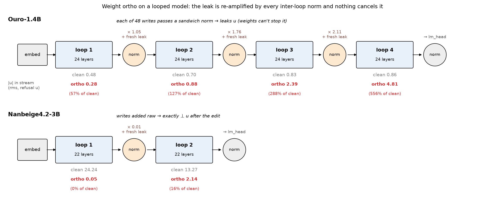

- Each pass of the shared norm adds a **fresh leak** and **rescales** the `u` already carried. In the clean model the
  next loop's writers push back against `u` (restoring slope −0.1 to −0.19 per loop); **weight ortho removes exactly
  that ability.**
- **Ouro:** the norm scales the stream **up** (×1.05 → ×2.1), 3 times: `u` grows 0.28 → 0.88 → 2.39 → 4.81, **5.6× clean**.
- **Nanbeige:** the stream is huge (length ≈ 2780), so the norm scales it **down 70×**: one fixed offset of 16% of
  clean, and loop 2 writes 10× more than it inherits.

---

## The same thing, per loop

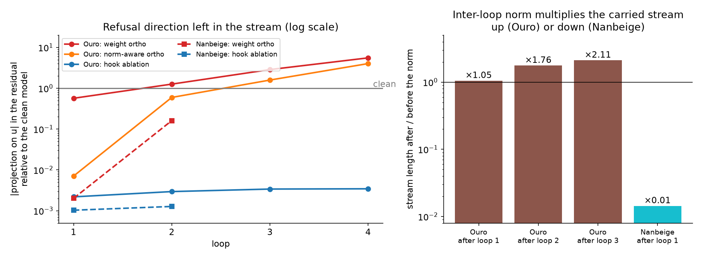

- Hooks keep `u` below 0.4% of clean in both models: they re-project after every norm.
- Ouro weight ortho grows past clean by loop 2. Norm-aware ortho fixes leak 1 (loop 1 ≈ 0), but leak 2 still grows it.
- Nanbeige weight ortho: one small step, then the model ends.

---

## Testing the explanation

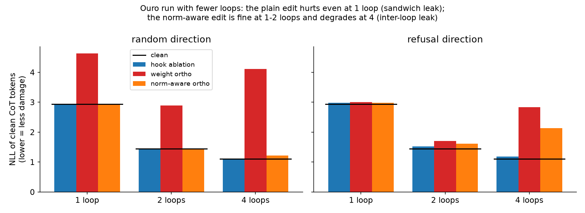

Two fixes, each targeting one leak: **norm-aware ortho** (edit against `g ⊙ u`; fixes leak 1) and **fewer loops**
(removes leak 2).

- Plain ortho with a random direction hurts at every loop count → leak 1.
- Norm-aware ortho matches hooks at 1–2 loops and degrades at 4 → leak 2 needs several passes.
- In generation (4 loops): norm-aware ortho is harmless with a random direction (63% refusal vs 57% clean) but leaves
  99% of CoTs unclosed with the refusal direction → **the inter-loop norm is the main cause**.

---

## Can weights alone fix leak 2? No.

Exact fix: also remove `g ⊙ u`, `g² ⊙ u`, … (one direction per inter-loop pass).

| Model | projection on `u` | damage (NLL, random `u`) |
|---|---|---|
| Ouro, rank-4 edit | ≈ 0 in every loop ✓ | 9.6 (clean 1.1) ✗ |
| Nanbeige, rank-2 edit | ≈ 0 in every loop ✓ | 11.7 (clean 1.5) ✗ |

The extra directions put 34–48% of their weight on the **top 1% highest-gain dimensions**, which the model depends on.
**No weight-only edit ablates a direction in a looped model with an amplifying inter-loop norm.**

---

## Is it Ouro's early-exit training?

Logit lens on clean traces (decode each loop's output directly):

| Model | NLL by loop | agreement with final output |
|---|---|---|
| Ouro | 2.93 → 1.44 → 1.12 → 1.11 | 61% → 80% → 92% → 100% |
| Nanbeige | 8.36 → 1.55 | 34% → 100% |

- Ouro (trained so any loop can exit) carries near-finished outputs from loop to loop and refines them; its writes
  mostly correct an inherited state, which is what leak 2 corrupts.
- Nanbeige's loop 1 output is not decodable; loop 2 mostly rewrites it.
- Consistent with early-exit training, **not proven**: no same-architecture model without early exit to compare.

---

## Takeaways

1. **The method transfers.** One difference-in-means direction removes most refusal in both looped models
   (Ouro 61% → 10%, Nanbeige 78% → 11–18%), as in Qwen (61% → 6%).
2. **Use hooks on looped models.** Weight ortho equals ablation only when nothing renormalizes the stream after the
   edited weights. Ouro breaks twice: sandwich norms re-add `u` to every write, and the amplifying inter-loop norm
   compounds the leak while the edit stops the model from correcting it. Nanbeige survives (raw writes, shrinking norm).
3. **Refusal is decided late, but not in one loop.** Later loops carry most of the effect; ablating loop 1 alone
   barely helps; no single loop matches all loops. One direction (last loop's) works in every loop.
4. **Ablation and actadd differ.** Ablation needs a late loop and costs no capability; actadd is a dose over loops,
   works at early-to-middle layers of late loops, and costs 4–16 points of math accuracy.
5. **Check damage, not just refusal:** unclosed CoTs reveal broken edits; selection-set loop results were optimistic.

---

## Caveats

- Directions, sites and loop configs are chosen on 50 selection prompts; headline and loop-profile numbers are on the
  487 test prompts. The loop × layer map, the all-subsets sweep and Ouro's weight edit are selection-set only.
- Sampling is temperature 0.6 without top-p/top-k (the models recommend top_p 0.95, top_k 20).
- About 20% of clean Ouro samples answer without thinking; ablation lowers this to 11–15%. Looping to the 8192 cap:
  0.2% clean, about 2% ablated.
- AIME 2025 at 8192 tokens is a weak capability test (most CoTs do not close). Over-refusal is a weak check.
- Mechanism numbers come from 8 traces (≈ 2.7k tokens) per model, one refusal site each.
- Some Nanbeige edits damage generation: the `v4_cot` loop-1 weight edit leaves 47% of CoTs unclosed (selection). Nanbeige
  runs on our own vLLM port (matches HF greedy outputs exactly).

---

## Next steps

1. **Why late loops?** Ablate loop 1 only and measure how much of `u` loops 2–4 rebuild (HF hooks, cheap); compare with
   the restoring slope from the mechanism analysis.
2. **Two-loop Ouro with norm-aware ortho** in generation: a direct test that leak 2 needs several passes (needs a
   loop-count override in the vLLM engine).
3. **Position-restricted ablation:** prompt vs CoT vs answer tokens; is the decision made before thinking?
4. **Statistics:** bootstrap confidence intervals over prompts for every table.
5. **Capability at a longer cap** (AIME at 16–32k tokens) and actadd at matched strength across models.
6. Remaining sweeps: `paired_cot` directions, actadd coefficients, a teacher-forced per-loop screen; explain the Qwen
   whole-CoT gap (15% vs the paper's 7.5%).

---

## Appendix: every subset of loops (50 selection prompts)

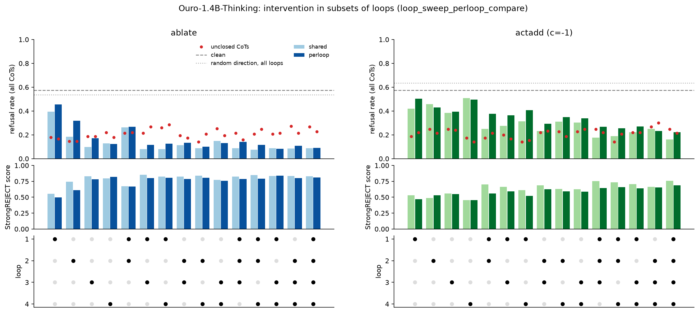 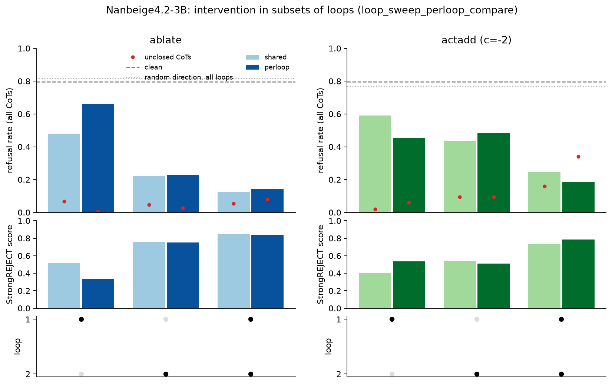

Light = one direction (last loop) in all selected loops; dark = each loop's own direction. Red dots: unclosed CoTs.
Ouro clean 57%, Nanbeige 80%. Ablation in one loop: Ouro 40 / 18 / 10 / 13%, Nanbeige 48 / 22%.

---

## Appendix: reproduce

```bash
# test-set run of loop configs (generate, judge, continue capped CoTs, judge, summarize)
GPU=0 scripts/run_test_set.sh ouro test_loops ablate:v4_baseline:t3.l16:apply=2 actadd:v4_baseline:t3.l16:c=-1
# loop-subset sweeps (selection prompts) and the loop x layer map
GPU=0 ACTADD_C=-1 VARIANT=shared scripts/run_loop_sweep.sh      # then VARIANT=perloop; MODEL_KEY=nanbeige ACTADD_C=-2
uv run python scripts/loop_sweep_summary.py loop_sweep loop_sweep_perloop --model Ouro-1.4B-Thinking
# capability
uv run python scripts/capability.py --gpu 0 --model ByteDance/Ouro-1.4B-Thinking --dataset math500 --tag cap \
    --candidates none ablate:v4_baseline:t3.l16
# mechanism comparison (HF)
uv run python scripts/ortho_compare.py --gpu 0 --model ByteDance/Ouro-1.4B-Thinking --direction v4_baseline:t3.l16 --loops 1,2
# queue jobs back to back on one GPU; figures for this deck (CPU)
scripts/gpuq.py add -n NAME -- CMD ...;  uv run python scripts/make_presentation_figures.py
```

Candidate syntax uses 0-based loops (`t3` = loop 4). Summary tables: `results/<model>/*.csv`, `results/capability_summary.csv`.
