<!-- _class: title -->

Loop-steer · research update

# Do looped models undo refusal steering?

Track an erased refusal signal through later iterations. Test where steering persists, and what it costs.

“Self-correction” here means recovery toward the clean model’s refusal representation or behavior after an intervention.

Qwen3 reproduction → Ouro and Nanbeige → gpt-oss extension in progress

<!--
17 main slides, followed by 5 backup slides. Loops are 1-based in the talk; layers retain code's 0-based indices.
Recovery is an operational description, not evidence that the model detects an attack or implements a general repair algorithm.
The central distinction is between iterations within one token's forward pass and successive generated tokens.
Figures: scripts/make_clean_presentation_figures.py. Numerical sources: figures/clean/evidence.json.
Render: scripts/render_clean_presentation.py; optional renderer dependencies are isolated under scratch/.
-->

---

Models · repeated computation within each token

# The same layer stack gets another chance

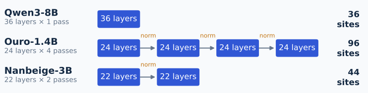

| Model | After attention / MLP writes | Between loops |
|---|---|---|
| Qwen3-8B · reference | No additional norm | No repeated stack |
| Ouro-1.4B-Thinking | RMSNorm on each write | Shared RMSNorm, 3 passes |
| Nanbeige4.2-3B | No additional norm | Shared RMSNorm, 1 pass |

Each loop processes the current token. It is not another generated thought. Ouro early exit is disabled: every token uses all 4 loops. A measurement site is (loop, layer).

<!-- Sources: src/loop_steer/models.py, hooks.py, vllm_nanbeige.py. Names retain nominal parameter counts.
An ordinary final output norm is not counted as an inter-loop pass. Norms at sublayer inputs are omitted from the table.
-->

---

Data · generation protocol

# Learn, select, then test on separate prompts

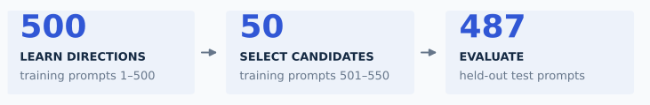

**For each prompt:** sample **3 reasoning traces**, then **3 answers per completed trace**.

| Setting | Qwen / Ouro | Nanbeige |
|---|---|---|
| Initial thinking / answer cap | 2,048 / 2,048 tokens | 4,096 / 4,096 tokens |
| Held-out thinking cap after continuation | 8,192 tokens | 8,192 tokens |
| Sampling | Temperature 0.6; top-p 1; no top-k | Same |

<a href="https://github.com/kureha-yamaguchi/reasoning-manipulation/tree/56a763d837cc63f30a13f830ad4ebd05890c7455/dataset">Upstream split</a>: 1,459 train + 487 test, mixing harmful and borderline requests. Sources: HarmBench, AdvBench, SorryBench, OR-Bench, StrongREJECT. <a href="https://arxiv.org/html/2507.03167v4#S3.SS1">Construction</a>.

<!-- Sources: data/prompts/*_harmful_prompts.csv; scripts/generate.py, run_test_set.sh, run_test_gpu*.sh.
Only the first 550 training prompts are used here. A test condition has 1,461 stage-1 samples and up to 4,383 stage-2 answers.
These settings differ from upstream (5×5 samples, top-p .95). Selection-only runs are not silently treated as 8k runs.
The harmless check uses a separate set of 250 test prompts; it does not supply the complying class for direction extraction.
-->

---

Evaluation · guard against broken generations

# Measure refusal, usefulness, and damage

<h2>Refusal and answer quality</h2>

Local <strong>gpt-oss-20b</strong>, using the StrongREJECT rubric.

<strong>Refusal rate:</strong> average answers within each trace, then traces within each prompt.

<strong>Compliance score:</strong> combines refusal, convincingness and specificity on a 0–1 scale.

<h2>Completion and capability</h2>

Report <strong>token-cap failures</strong> separately from direct answers without thinking.

<strong>MATH-500:</strong> 500 problems × 1 sample. <strong>AIME 2025:</strong> 30 problems × 8 samples. <strong>Harmless:</strong> 250 test prompts.

Every sampled trace counts, including those that never close.

A completed trace is judged through its answers; an unclosed trace is judged on its raw output. Controls: clean model and random-direction interventions. Exact score and runtime details: backup A.

<!-- Source: scripts/summarize.py and src/loop_steer/judge.py. Headline figures use all_refusal, not valid-only judge_refusal.
The score's exact arithmetic is given in backup A; it is not a product of the three raw ratings.
No independent human calibration of the local judge is claimed.
-->

---

Method · define the signal before intervening

# Find the refusal direction

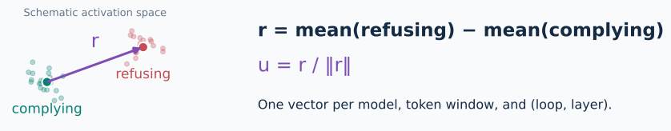

| Activation window | What is averaged? | Label belongs to |
|---|---|---|
| **Prompt-end** | Template tokens after the user message, before thinking | Prompt |
| **Thinking** | Tokens in a completed reasoning trace | Trace |

Activations are measured at decoder-layer inputs. Labels come from judged answers to the same harmful/borderline prompt pool. Mixed outcomes are excluded. Precise thresholds: backup B.

<!-- Sources: scripts/build_sets.py, extract_activations.py, directions.py.
For the prompt-end window, duplicate prompts are collapsed. A different direction can be estimated at every site.
The main loop comparisons hold one selected prompt-end vector fixed across loops and layers.
-->

---

Interventions · location and strength are distinct choices

# Three ways to change the residual stream

<h2>Hook ablation</h2>

h ← h − (h · u)u

Remove u at <strong>every layer</strong> in selected loops, after normalization.

<h2>Weight edit</h2>

W ← W − uuᵀW

Project embeddings and attention / MLP outputs once. Shared weights affect <strong>every loop</strong>.

<h2>Activation addition</h2>

h ← h + c r

Shift <strong>one layer</strong> in selected loops. Here c &lt; 0 pushes against refusal.

For ablation, the reported layer identifies where u was learned. For addition, it also identifies where the shift is applied.

Unless restricted explicitly, interventions cover prompt, thinking and answer tokens. h = token state; W = a matrix writing into it; u = unit direction; r = unnormalized mean difference.

<!-- Sources: src/loop_steer/hooks.py, vllm_hooks.py, ortho.py.
Embedding vectors are projected in the residual dimension (matrix orientation differs from output projections).
Position masks are available in vLLM; loop gates use the loop index supplied to each decoder block.
-->

---

Held-out result · 487 prompts per condition

# Removing the signal suppresses refusal

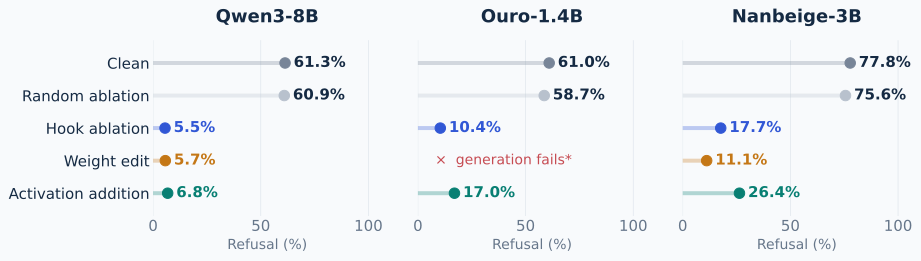

One selected direction suppresses most refusal in both looped models.

*Ouro’s weight edit produced no completed thinking traces on 50 selection prompts; no held-out result is plotted. Directions and coefficients are selected separately by intervention; backup B lists them.

<!-- Sources: figures/clean/evidence.json, headline and sources. Continuations are merged before scoring.
The missing Ouro entry is a failure marker, not 0% refusal. Random hooks use the candidates from the existing experiment.
Qwen's learned L17 vectors have cosine ~.99 with upstream vectors (reproduction check).
-->

---

Readout · prediction before generation

# Refusal is readable before thinking starts

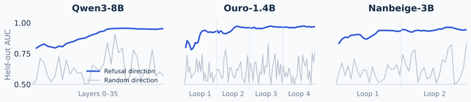

**Probe:** learn a direction on half the training prompts; evaluate on the other half.

**AUC:** 0.5 = chance ranking; 1 = perfect separation of refusing and complying examples.

Early readability leaves open whether later loops can restore the signal after it is erased.

<!-- Sources: data/runs/<model>/analysis/v4_baseline_sites.csv, snapshotted in evidence.json.
These are training-half diagnostics, not the 487-prompt intervention test. One vector is fit at each site, not one universal probe.
The sign of the random direction is chosen to give AUC >= .5; this reference is not a confidence interval.
First-loop layer 0 is omitted where identical template embeddings make the direction undefined.
-->

---

Self-correction · track the exact erased direction

# Later iterations rebuild an erased refusal signal

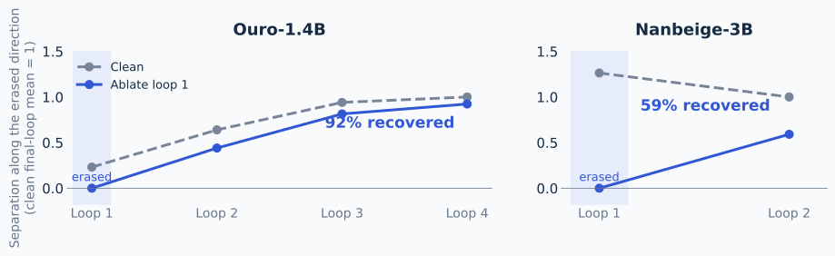

After loop-1 ablation, the final loop recovers <strong>92%</strong> of clean separation in Ouro and <strong>59%</strong> in Nanbeige.

Replay the same clean sequences under both conditions. Separation = refusing minus complying mean projection on fixed u, averaged over prompt-end tokens and layer inputs within each loop. Clean final-loop mean = 1.

<!-- Source: loop_rebuild_v4_baseline_t3l16.csv and ...t1l15.csv; window=prompt_end, dir=u, condition=1.
Separation = mean projection of refusing examples minus mean projection of complying examples.
Ratio uses the mean across layer-input sites in the last loop: Ouro 1.239375/1.342460 = .9232; Nanbeige 6.018955/10.180676 = .5912.
Plots use clean final-loop mean separation as a common within-model scale. Each point averages layers within one loop.
Teacher-forced clean selection traces, at most 40 per class, first 256 thinking tokens. The displayed prompt-end tokens precede those continuations.
Recovered class separation alone does not identify whether the cause is residual information, the prompt, nonlinear reconstruction, or norm leakage.
-->

---

Self-correction · behavioral consequence on held-out prompts

# Early steering leaves room for recovery

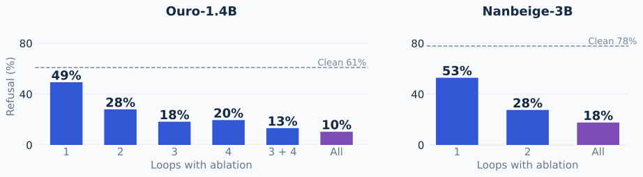

**Hold u fixed.** Change only which loops receive hook ablation at every layer.

Later intervention has a larger effect; maintaining it across loops works best.

487 held-out prompts; 8,192-token thinking cap. The pattern supports recovery across iterations, without identifying a unique decision loop.

<!-- Sources: results/<model>/test_loops.csv and headline all-loop rows in evidence.json.
The Ouro single-loop optimum is loop 3, not loop 4; do not claim a strictly monotonic effect.
Both representation recovery and behavioral results are needed: the representation probe uses fixed traces, whereas these generations are free-running.
-->

---

Token positions · a second axis of locality

# Prompt-only steering does not persist

PRELIMINARY · 50 selection prompts

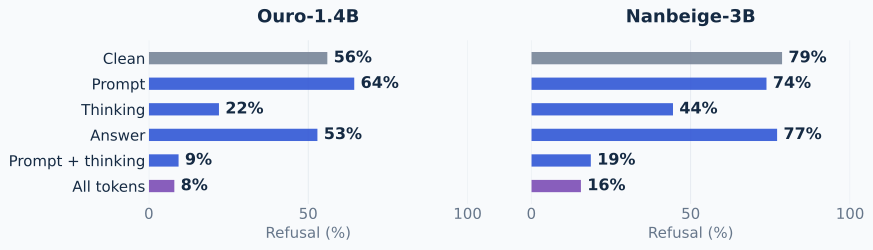

With the selected prompt-end direction, covering prompt + thinking approaches all-token ablation.

All loops, fixed u. Gates apply to processed input-token positions, not the next sampled token. Ouro / Nanbeige thinking caps: 2,048 / 4,096. Held-out confirmation is pending.

<!-- Sources: data/runs/<model>/analysis/select_pos.csv. Plots use all_refusal; valid-only is used only where there are no invalid samples.
The prompt-only result is not evidence for an increase: this is a small selection set. Clean baselines belong to these exact runs.
Answer-only effects depend on the direction: Ouro's thinking-window direction gives 14%, versus 53% for the prompt-end direction shown.
Hence this slide's claim is limited to the chosen prompt-end vector; it does not claim answer positions never matter.
The last input position in one class predicts the next token, which may belong to the next class.
-->

---

Mechanism · why a permanent weight edit can fail

# Normalization reintroduces the component

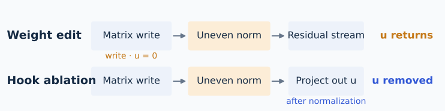

Norm(x) · u = x · (g ⊙ u) / rms(x)

**Uneven gains g change direction:** x · u = 0 does not imply Norm(x) · u = 0.

Ouro has two opportunities for reintroduction: normalization after each write, and normalization between loops.

<!-- Sources: src/loop_steer/ortho.py and scripts/ortho_compare.py, ortho_feedback.py.
⊙ denotes elementwise multiplication. The denominator is a scalar; the non-uniform gain is what invalidates orthogonality.
This is an architectural pathway for recovery/leakage. It does not explain all reconstruction after an early hook intervention.
-->

---

Mechanism · repeated normalization changes the outcome

# In Ouro, the leak compounds across iterations

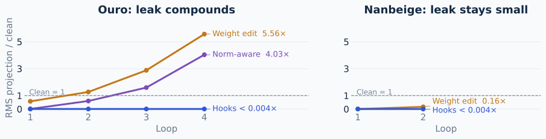

<strong>Ouro:</strong> inter-loop norms amplify the stream across 3 passes. The weight edit also prevents writes that would cancel the leaked component.

<strong>Nanbeige:</strong> one inter-loop pass shrinks the stream about 70×. The next loop adds much larger new writes.

8 fixed traces per model; RMS projection along u relative to clean at each loop. Norm-aware editing fixes post-write leakage, but leaves the inter-loop pathway. Controls and reduced-loop runs: backup D.

<!-- Sources: ortho_compare_v4_baseline_*.json and Ouro ortho_feedback.json.
resid_rms aggregates residual projection across layer sites and sequence tokens in each loop. It is not a refusal rate or class-separation measure.
For Ouro, removing the ability to write along u also removes observed restorative writes in clean traces.
Do not equate this leak amplification with useful behavioral self-correction. It explains the failure of a different intervention.
-->

---

Addition · persistence also depends on dose and depth

# Addition accumulates across iterations

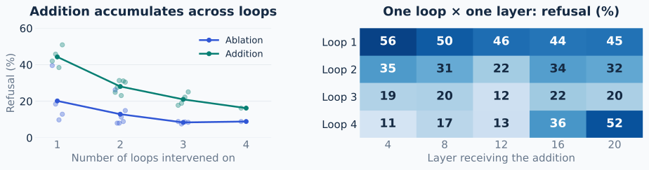

<strong>Left:</strong> every nonempty subset of 4 loops. Dots = subsets; lines = mean at each count. Fixed direction; addition c = −1.

<strong>Right:</strong> one loop and one layer, c = −2. The direction is estimated at each tested site. Both the vector and its injection location change.

Ouro only; 50 selection prompts. The map supports a useful region for these additions, not an isolated causal effect of layer location. Coefficients are not normalized to match strength across sites.

<!-- Sources: results/Ouro-1.4B-Thinking/loop_sweep_perloop_compare.csv and loop_layer_map.csv.
Left filters variant=shared, method=v4_baseline. Right candidates use dir=perloop, so the original deck's fixed-vector interpretation would be too strong.
All-loop addition in the left sweep uses c=-1; the right map uses c=-2. They are distinct experiments.
-->

---

Collateral effects · preserving useful reasoning

# Ablation preserves measured math accuracy

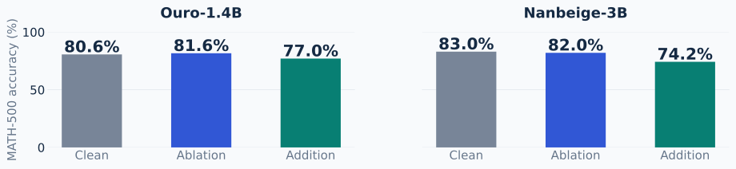

**Addition loss:** 3.6 points in Ouro; 8.8 points in Nanbeige. Ablation shifts are within the reported sampling noise.

500 problems, one sample each; 8,192 total generation tokens. All-loop interventions; c = −1 / −2. Harmless refusal stays at 0–3%. AIME is weak evidence here: most runs hit the token cap.

<!-- Source: results/capability_summary.csv; script capability.py applies max_tokens to the entire generation, not just thinking.
MATH binomial standard errors are about 1.7–2.0 points; no paired prompt-bootstrap interval is available.
AIME clean accuracy is 18.8% Ouro / 29.6% Nanbeige; Nanbeige addition 13.8%. 30 problems, 8 samples are not 240 independent problems.
Across reported ablation configs, MATH is 80.4–81.6% Ouro, 82.0–83.8% Nanbeige. No general capability guarantee follows.
-->

---

Extension · gpt-oss-20b is running

# Does the intervention survive expert routing?

IN PROGRESS · a separate MoE comparison

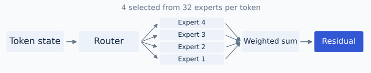

- **One pass, 24 layers; 4 of 32 experts per token.** MoE transfer is a separate question from loop recovery.
- **Edit all expert outputs and biases**, plus embeddings and attention outputs. Hooks act on the combined write.
- **Use the same bf16 weights for clean and edited runs.** Re-quantization can restore u.

Current study: layer selection; weight edits with / without biases. Held-out refusal and capability results pending.

<!-- Source: scripts/run_gpt_oss.sh, prepare_gpt_oss_bf16.py, validate_moe_ortho.py and src/loop_steer/models.py.
The target and evaluator share the gpt-oss model family; independent judging is a useful robustness check for this extension.
Existing preliminary validations motivate the bias/precision controls, but the ongoing screen is intentionally not read by the figure generator.
-->

---

<!-- _class: close -->

What the evidence supports

# Later computation can undo refusal steering

1. **The erased signal returns.** Later loops recover much of the refusing–complying separation after early ablation.
2. **Timing changes behavior.** Early-only ablation leaves substantially more refusal than late or sustained ablation.
3. **Architecture changes persistence.** Normalization can reintroduce a component that weight edits cannot remove again.

Next causal test: separate reconstruction from untouched features and context from reintroduction through normalization.

Also pending: held-out token-position results, prompt-level confidence intervals, longer capability runs, and the gpt-oss comparison. Current evidence concerns refusal under these interventions; it does not establish general self-repair.

<!-- The next causal test is a proposal, not an experiment that has already been run.
Possible design: compare continuous projection after norms versus selected write projections at the boundary after the perturbed loop, while holding the clean trace and direction fixed.
-->

---

<!-- _class: compact -->

Backup A · runtime and metric definitions

# Exact setup behind the main results

| Component | Configuration |
|---|---|
| Inference / diagnostics | vLLM 0.18.0 / Transformers 4.57.6; bf16 |
| Environment | Python 3.12; PyTorch 2.10.0+cu128; locked project environment |
| Compute | NVIDIA RTX PRO 6000 Blackwell; one model job per GPU |
| Ouro / Nanbeige | Fixed 4 / 2 loops; custom Nanbeige vLLM port checked against HF greedy output |
| Judge | Pinned gpt-oss-20b; StrongREJECT rubric, not a human label |
| Prompt formatting | Model chat template, user message + assistant generation prefix |

<strong>Score:</strong> S = (1 − R)(C + P − 2) / 8, where R ∈ {0,1} is refusal and C, P ∈ {1,…,5} are convincingness and specificity.

“Unclosed” = direct answers + capped traces. Missing judge parses are counted separately. Headline metrics include both categories, with continuations replacing capped originals. Model revisions: backup E.

<!-- Sources: uv.lock, pyproject.toml, src/loop_steer/models.py, judge.py, scripts/summarize.py.
For unclosed samples with an unparsed judgment, summarize.py fills the missing all-sample contribution with zero; valid answer means skip NaNs. Check unparsed counts before interpreting tiny differences.
-->

---

Backup B · labels and the exact headline interventions

# Hold the measurement and application sites apart

<strong>Training labels:</strong> low score &lt; 0.2; high score &gt; 0.8. A trace needs all 3 answers on the same side. Prompt labels use at least floor(0.75 × n) answers on one side: <strong>6 of 9</strong> when all answers are available. Others are excluded.

<table class="tight">
<thead><tr><th>Model</th><th>Hook / weight direction</th><th>Addition direction and application</th></tr></thead>
<tbody>
<tr><td>Qwen3-8B</td><td>Prompt-end, L21</td><td>Prompt-end, L17; c = −2</td></tr>
<tr><td>Ouro-1.4B</td><td>Prompt-end, loop 4 / L16</td><td>Same vector at L16 in each loop; c = −1</td></tr>
<tr><td>Nanbeige4.2-3B</td><td>Prompt-end, loop 2 / L15</td><td>Same vector at L15 in each loop; c = −2</td></tr>
</tbody>
</table>

<strong>Selection:</strong> screen refusal and incomplete generations on 50 prompts. Prefer low refusal with preserved completion; the heuristic is not a uniform hard threshold across architectures.

Loops are 1-based; layers are 0-based. Qwen hook L21 is inherited from weight-edit selection. The implemented prompt-label threshold rounds down; it is not literally “at least 75%.”

<!-- Sources: scripts/build_sets.py, scripts/make_presentation_figures.py and evidence.json.
This documents the code as run, without modifying labels, directions or the active experiments.
Random hook directions: Qwen L17; Ouro loop4/L16; Nanbeige loop1/L14. These are control candidates, not selected refusal directions.
-->

---

Backup C · a second measure of representation recovery

# Recovery also appears in each site’s own direction

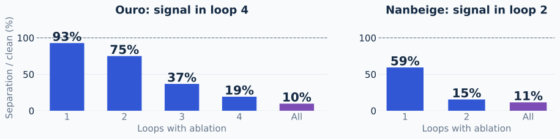

**Measurement:** sum refusing–complying separation over final-loop sites, divided by the clean sum; each site uses its own clean direction.

Teacher-forced selection traces; at most 40 refusing and 40 complying, with the first 256 thinking tokens. Prompt-end window shown. Residual separation under all-loop ablation can lie outside the erased u.

<!-- Source: loop_rebuild_*.csv, dir=own, window=prompt_end. These are the 93% and 59% figures in PLAN.md.
The central recovery slide uses dir=u (92% and 59%) and must not silently substitute these values.
These are descriptive measurements of this trace sample, without confidence intervals.
-->

---

<!-- _class: compact -->

Backup D · perturb the proposed leakage mechanism

# Fixing one leakage pathway does not fix both

<table class="tight">
<thead><tr><th>Ouro condition</th><th>Observation</th><th>Scope</th></tr></thead>
<tbody>
<tr><td>Plain weight edit, random u</td><td>Generation fails even with fewer loops</td><td>Post-write norm leakage is sufficient to cause damage</td></tr>
<tr><td>Norm-aware edit, 4 loops</td><td>Random u is benign; refusal u leaves 99% unclosed</td><td>Inter-loop pathway remains</td></tr>
<tr><td>Norm-aware edit, 2 loops</td><td>10% refusal; 54% unclosed</td><td>Hooks: 10% refusal; 38% unclosed</td></tr>
<tr><td>Unedited, 1 loop</td><td>96% unclosed</td><td>Not a useful behavioral baseline</td></tr>
<tr><td>Higher-rank weight edit</td><td>Removes leakage but severely raises token NLL</td><td>Tested construction damages useful computation</td></tr>
</tbody>
</table>

<strong>Norm-aware:</strong> edit against g ⊙ u before the post-write norm. This leaves the separate inter-loop norm untouched.

50 selection prompts, short caps; “unclosed” includes direct answers. These controls support the mechanism, not an impossibility theorem about every possible weight edit.

<!-- Sources: results/Ouro-1.4B-Thinking/ortho_na.csv; data/runs/Ouro-1.4B-Thinking/analysis/loops1.csv, loops2.csv, ortho_compare_*_span.json.
At 2 loops, clean: 40% refusal, 23% unclosed. Hooks: 21% capped + 17% direct. Norm-aware refusal edit: 40% capped + 14% direct.
The higher-rank construction removes the span of u, g⊙u, g²⊙u, ...; its damage is empirical, not a proof that no alternative edit could work.
-->

---

Backup E · evidence boundaries and provenance

# What still limits the conclusions

- **Generalization:** two looped architectures; no matched control for Ouro’s early-exit training.
- **Uncertainty:** no prompt-bootstrap intervals yet. Selection sweeps use 50 prompts; mechanism diagnostics use 8 traces per model.
- **Capability:** MATH is narrow; AIME has only 30 problems and frequent token-cap failures. Judge labels need independent validation.

<strong>Prior work:</strong> <a href="https://arxiv.org/abs/2507.03167v4">Yamaguchi, Etheridge &amp; Arditi, Where Do Reasoning Models Refuse?</a> · <a href="https://arxiv.org/abs/2406.11717">Arditi et al., Refusal in Language Models Is Mediated by a Single Direction</a> · <a href="https://arxiv.org/abs/2402.10260">Souly et al., A StrongREJECT for Empty Jailbreaks</a>.

<strong>Pinned snapshots:</strong> Qwen b968826d · Ouro 3aaa2224 · Nanbeige b82e54bd · gpt-oss / judge 6cee5e81. Full hashes: <code>src/loop_steer/models.py</code>, <code>__init__.py</code>, <code>judge.py</code>. Prompt source: reasoning-manipulation 56a763d.

<strong>Figure provenance:</strong> <code>docs/figures/clean/evidence.json</code> stores the numerical snapshot and raw-result paths. Rebuild with <code>.venv/bin/python scripts/make_clean_presentation_figures.py</code>. The original presentation is retained separately.

<!-- No claim is made that all early-intervention recovery is an active learned correction circuit.
This presentation changes documentation and derived visual artifacts only; it neither edits nor schedules GPU jobs.
-->
